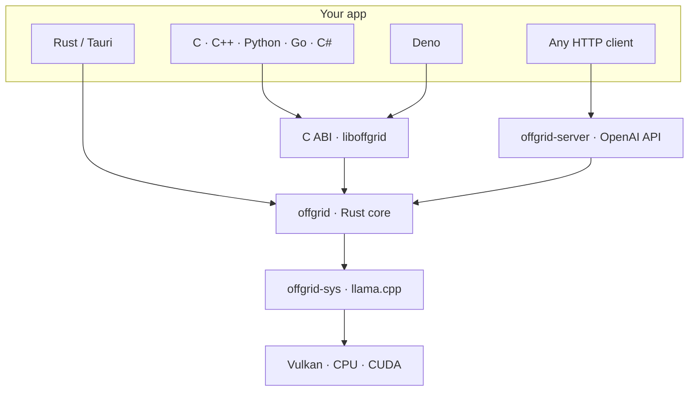

# offgrid: embeddable offline AI

[](https://github.com/Pinta365/offgrid/actions/workflows/ci.yml)

offgrid is a small native library that adds local, offline AI to an application: chat, tool
calling, structured JSON output, embeddings, image and audio input, and image generation. You link a library,
ship a GGUF model next to your app, and that's it. No daemon, no Docker, no cloud, and no
network access at runtime.

It is written in Rust on top of [llama.cpp](https://github.com/ggml-org/llama.cpp). It runs
on any GPU through Vulkan, falls back to the CPU automatically, and is packaged for Linux and
Windows.



## What it does

| Capability | Details |
|---|---|
| **Chat** | Streaming generation with stop strings, token limits, sampling options and seeds. Requests follow the OpenAI format and are stateless; the session reuses the matching prefix of its KV cache, so follow-up turns only process new tokens. |
| **Chat templates** | Each model's own Jinja template (stored in the GGUF) is rendered with minijinja the way Hugging Face does it. 69 of the 72 real-world templates in llama.cpp's test corpus render; the other 3 refuse by design (for example, Gemma 2 has no system role). If a template can't be used, llama.cpp's built-in formats are the fallback. |
| **Structured output** | OpenAI `response_format` (`json_object` or `json_schema`) is compiled into a llama.cpp grammar, so the output is valid by construction. The converter handles objects, arrays, enums, `anyOf` / `oneOf` / `allOf`, `$ref` / `$defs`, and string formats, patterns and lengths. Properties are generated in the order they are declared. |
| **Tool calling** | OpenAI `tools`, `tool_choice` and `parallel_tool_calls`. Tool calls are parsed from the model's native format: Hermes/Qwen, Llama 3.x, Mistral, Qwen3-Coder XML, or generic JSON. If a model's template ignores tools (Gemma 3, for example), the tools and the call format are described in the system message instead, and earlier calls and results are written into the conversation as text. A grammar keeps the arguments valid against each tool's schema. Loop helpers (`run_tools`, `runTools`) handle the call, execute and feed-back cycle. |
| **Reasoning** | Thinking models' `<think>` blocks are separated into `reasoning_content` and streamed as their own events. |
| **Vision and audio** | Images (PNG, JPEG, …) and audio (WAV, MP3, FLAC) are sent as OpenAI content parts. Several items per message and mixed image and audio both work. Encoded media is reused across turns from the KV cache and is not decoded again. |
| **Code completion** | Fill-in-the-middle for code models with FIM tokens (Qwen2.5-Coder, ...), laid out like llama.cpp's `/infill`: extra context from other files, the code before and after the cursor, and stops at a time limit or at a less-indented line. llama.cpp's infill sampler (on by default) ends a completion once the model is unsure how to go on, which keeps suggestions short and fast. Completions that share a prefix reuse the KV cache. |
| **Embeddings** | Batched and L2-normalized, with float or base64 output. |
| **Image generation** | Text-to-image and image-to-image through [stable-diffusion.cpp](https://github.com/leejet/stable-diffusion.cpp) (Z-Image, FLUX, SD 1.x/2.x/XL, ...), built on the same ggml as llama.cpp. Progress (loading, sampling, decoding) and cancellation; PNG or RGB output. Runs alongside chat in the same process. Feature `image`; included in the release packages. |
| **Cancellation** | Requests can be cancelled from any thread. Cancellation is scoped to one request and never affects a later one. |
| **Server** | `offgrid-server`: OpenAI-compatible HTTP with SSE streaming, a session pool, cancellation when the client disconnects, an optional API key, and graceful shutdown. |

## Using it

### Rust (or Tauri)

`cargo add offgrid` (builds llama.cpp from source: CMake, a C/C++ compiler and, for the default
`vulkan` feature, the Vulkan headers and `glslc`; `default-features = false` for CPU only).

```rust
use offgrid::*;

let model = Model::load("qwen3-4b.gguf", &ModelParams::default())?;
let mut chat = ChatSession::new(model, &SessionParams::default())?;

let req = ChatRequest::new(vec![ChatMessage::user("Name three rivers.")]);
let resp = chat.complete(&req, |piece| { print!("{piece}"); true })?;   // return false to cancel
println!("\n{:?} {:?}", resp.finish_reason, resp.usage);
```

Images or audio need the model's projector:

```rust
let model = Model::load("qwen2.5-vl-3b.gguf", &ModelParams { mmproj: Some("mmproj.gguf".into()), ..Default::default() })?;
let msg = ChatMessage::user_with_media("What's in this picture?", vec![Media::from_path("photo.jpg")?]);
```

Image generation (feature `image`, which needs offgrid from git: stable-diffusion.cpp's sources
are too large for crates.io):

```rust
let mut images = ImageModel::load(&ImageModelParams {
    diffusion_model: Some("z_image_turbo-Q4_K.gguf".into()),
    text_encoder: Some("qwen3-4b.gguf".into()),
    vae: Some("ae-f16.gguf".into()),
    ..Default::default()
})?;
let req = ImageRequest { prompt: "A lighthouse at dusk".into(), width: 768, height: 512, steps: Some(8), cfg_scale: Some(1.0), ..Default::default() };
let png = images.generate(&req, |progress| { println!("{progress:?}"); true })?.to_png();
```

The main entry points are `ChatSession::complete_stream` (content, reasoning and tool-call
events), `run_tools` (the tool loop), `ChatSession::infill` (code completion), `Embedder::embed`
and `ImageModel::generate`. See `crates/offgrid/examples/`, and
`examples/tauri/` for a desktop chat app that embeds the crate.

### C / C++ (and anything with a C FFI)

`include/offgrid.h` exposes 26 functions (including image generation: `offgrid_image_model_load`,
`offgrid_image_generate` returning PNG bytes). Requests and results are JSON in the OpenAI format,
so new features don't change the ABI.

```c
char *err = NULL;
offgrid_model *m = offgrid_model_load("qwen3-4b.gguf", NULL, &err);
offgrid_chat  *c = offgrid_chat_new(m, NULL, &err);
char *resp = offgrid_chat_complete(c,
    "{\"messages\":[{\"role\":\"user\",\"content\":\"Hi!\"}],\"max_tokens\":100}",
    on_token, NULL, &err);          /* bool on_token(const char *piece, size_t len, void *user) */
/* ... */
offgrid_string_free(resp); offgrid_chat_free(c); offgrid_model_free(m);
```

Conventions:
- Fallible functions take a trailing `char **error_out`.
- Returned strings belong to the caller and are freed with `offgrid_string_free`.
- Panics never cross the FFI boundary.
- `offgrid_chat_cancel` and `offgrid_chat_cancel_request` are safe to call from any thread.

ABI version: `offgrid_abi_version()` (currently 1). Examples are in `examples/c/`.

### Deno

```ts
import { Offgrid, imagePart } from "jsr:@pinta365/offgrid";

using core = await Offgrid.load();  // $OFFGRID_LIB, the cache, or a one-time verified download of the release package
using model = await core.loadModel("qwen3-4b.gguf");
using chat = await model.createChat();

const res = await chat.complete(
  { messages: [{ role: "user", content: "Hi!" }] },
  { onToken: (t) => Deno.stdout.writeSync(new TextEncoder().encode(t)), signal: AbortSignal.timeout(30_000) },
);
```

Calls are nonblocking, so the event loop keeps running. The binding also offers:
- streaming through `onToken` and `onReasoning`, or as an async iterator with `chat.stream()`
- the tool loop `chat.runTools(request, handlers)`
- `imagePart()` and `audioPart()` helpers
- image generation: `core.loadImageModel(...)`, then `model.generate(request, { onProgress, signal })`
  returns PNG bytes
- `Disposable` handles that guard against freeing while a call is in flight

`Offgrid.load()` downloads this version's prebuilt package from the GitHub release on first use, checks its
SHA-256 and caches it; `Offgrid.open()` and `OFFGRID_LIB` never touch the network. See the
[package README](bindings/deno/README.md) for the details and permissions. Examples are in `examples/deno/`.

### HTTP (any language): `offgrid-server`

```sh
bin/offgrid-server --model qwen3-4b.gguf [--embedding-model embed.gguf] [--mmproj mmproj.gguf] \
                  [--fim-model qwen2.5-coder-1.5b.gguf] \
                  [--image-diffusion-model z_image_turbo.gguf --image-text-encoder qwen3-4b.gguf --image-vae ae.gguf] \
                  [--port 8080] [--parallel 2] [--ctx 8192] [--api-key KEY]
```

Point any OpenAI client at `http://127.0.0.1:8080/v1`. The server provides:
- `POST /v1/chat/completions`, with or without SSE streaming, including
  `delta.reasoning_content` and `delta.tool_calls`
- `POST /v1/completions`: a raw text prompt, or fill-in-the-middle when `suffix` is set
- `POST /infill`: llama.cpp's code-completion endpoint (`input_prefix`, `input_suffix`,
  `input_extra`, `n_indent`, `t_max_predict_ms`), so editor plugins such as llama.vscode work
- `POST /v1/embeddings`
- `POST /v1/images/generations` (`b64_json`, plus `steps`, `cfg_scale`, `seed`, `negative_prompt`
  and `init_image`/`strength` for image-to-image)
- `GET /v1/models` and `GET /health`

Code completion uses `--fim-model` if given, else the chat model (which then needs FIM tokens).
A request can pick either model by its `model` id.

Compatibility has been checked with the official `openai` npm SDK (`scripts/openai-compat.ts`).
The server binds to localhost by default; use `--api-key` before exposing it.

## Tested models

Every model below was exercised end to end by the test suites on an RX 9070 XT (Vulkan).

| Model | Used for | Notes |
|---|---|---|
| Qwen3-4B-Instruct-2507 Q4_K_M | Chat, JSON schema, tools, server | Reference model; all tool-calling scenarios pass |
| Llama-3.2-3B-Instruct Q4_K_M | Llama 3 tool format | Formats calls correctly but judges poorly when to call tools (llama-server behaves the same) |
| Qwen3-0.6B Q8_0 | Reasoning streaming | Use temperature 0.6 in thinking mode; greedy decoding loops |
| Qwen3-Embedding-0.6B Q8_0 | Embeddings | |
| Qwen2.5-Coder-1.5B Q8_0 | Code completion (FIM) | Repo-level format with extra files; ~200 tokens/s on the RX 9070 XT |
| Qwen2.5-VL-3B + mmproj | Vision (M-RoPE) | Colors, counting, OCR, JPEG, multiple images |
| Gemma 3 4B + mmproj | Vision, tools without template support | Template ignores tools; uses the system-message fallback |
| Qwen2.5-Omni-3B + mmproj | Audio and vision | Word-perfect transcription from WAV, MP3 and FLAC |
| Ultravox 0.5 (Llama 3.2 1B) + mmproj | Audio | Understands speech; unreliable at verbatim transcription |
| Z-Image-Turbo Q4_K + Qwen3-4B text encoder + VAE | Image generation | 8 steps, `cfg_scale` 1.0: 768×512 in ~5 s on the RX 9070 XT, 512×512 in ~2m45s on the CPU. Uses ~6.2 GB of GPU memory. Next to a chat model, `vae_tiling` keeps the weights resident between images; on small GPUs add `text_encoder_on_cpu` (saves 2.4 GB) or `max_vram_gib` |

Performance with Qwen3-4B Q4_K_M:

| Hardware | Prompt processing | Generation |
|---|---|---|
| RX 9070 XT (Vulkan) | ~5,000 tokens/s | ~150–175 tokens/s |
| Ryzen 7 9800X3D (CPU) | ~300 tokens/s | ~21 tokens/s |

## Platforms and packaging

| Platform | Status | Package |
|---|---|---|
| Linux x86_64 | Tested | `scripts/package-linux.sh` → `offgrid-<ver>-linux-x86_64.tar.gz` (~38 MB) |
| Windows x86_64 | Tested on Windows 11: package (RTX 3060 Laptop via Vulkan, and CPU), native MSVC build with the full test suite | `scripts/package-windows.sh` → `.zip` (~45 MB) |
| macOS, ARM | Not attempted yet | |

A package is a relocatable folder: `lib/` or `bin/` with `liboffgrid`, llama.cpp/ggml/mtmd,
stable-diffusion.cpp and the backends, plus `include/offgrid.h` and `offgrid-server`. Keep the folder together.

- **Runs on any x86_64 CPU.** It ships 14 CPU variants (from baseline x64 up to zen4 and
  sapphirerapids), and the best one for the machine is chosen at load time.
- **The GPU is optional.** Vulkan is a plugin module. Without a GPU, without a Vulkan driver,
  or with the module deleted, the library falls back to the CPU.
- **Linux: glibc 2.28.** That covers Ubuntu 20.04+, Debian 10+ and RHEL 8+. The build uses zig
  (`cargo-zigbuild`) with a static C++ runtime. The only runtime dependencies are glibc and
  libm, plus libvulkan for the GPU module. `$ORIGIN` RPATHs make the folder relocatable.
- **Windows** is built from Linux with llvm-mingw.
  - It depends only on Windows system DLLs, plus `vulkan-1.dll` from the GPU driver.
  - `offgrid.dll` delay-loads its dependencies from its own folder, so hosts such as Deno,
    Python or C# can load it by path from anywhere.
  - Import libraries are included for both MSVC and MinGW.
  - AMD's switchable-graphics Vulkan layer, which hangs Vulkan start-up on laptops with an AMD
    iGPU plus another GPU, is turned off for the process (`DISABLE_LAYER_AMD_SWITCHABLE_GRAPHICS_1`).

`scripts/check-portable.sh` and `scripts/check-windows.sh` verify each package: dependencies
resolve from inside it, a relocated copy runs, and the CPU fallback works.

Pushing a tag that matches the crate version (`v0.1.0`) runs the release workflow: it builds and
checks both packages and creates a draft GitHub release with them attached.

## Building from source

Requirements:
- Rust 1.88+
- cmake, ninja and a C/C++ compiler
- Vulkan headers and `glslc`, for example
  `omarchy pkg add cmake ninja vulkan-headers spirv-headers shaderc` on Arch/Omarchy

```sh
git submodule update --init
cargo build --release -p offgrid-ffi            # liboffgrid.{so,a} (static llama.cpp, dev build)
cargo run --release -p offgrid --example chat -- model.gguf
```

Features:
- `--no-default-features`: CPU only
- `--features cuda`: CUDA backend
- `--features dynamic-backends`: the portable runtime-loaded layout used by the packages
- `--features image`: image generation through stable-diffusion.cpp (on `offgrid`, `offgrid-ffi`
  and `offgrid-server`)

Cross-compiling for Windows needs [llvm-mingw](https://github.com/mstorsjo/llvm-mingw) in
`~/.local/share` and `rustup target add x86_64-pc-windows-gnullvm`. The Linux package uses zig
(`mise install zig@0.16.0`) and `cargo install cargo-zigbuild` when they are available.

Building natively on Windows (MSVC) needs Visual Studio Build Tools with the
C++ workload, CMake and the [Vulkan SDK](https://vulkan.lunarg.com/) (`VULKAN_SDK` set by its
installer). Clone, run `git submodule update --init` (not `--recursive`: stable-diffusion.cpp has nested
submodules offgrid doesn't use), then `cargo build --release`.

The bindings to llama.cpp are committed (`crates/offgrid-sys/src/bindings`), so building doesn't
need libclang. After bumping llama.cpp, regenerate them with `scripts/gen-bindings.sh`.

## Testing

```sh
cargo test --workspace                          # unit tests; model tests skip without models
(cd bindings/deno && deno task test)
```

Model-backed tests are enabled through environment variables pointing at GGUF files. On GPUs with
8 GB or less, add `-- --test-threads=1` so only one model set is loaded at a time.

| Variable | Enables tests for |
|---|---|
| `OFFGRID_TEST_MODEL` | chat, JSON, tools, server |
| `OFFGRID_TEST_LLAMA_MODEL` | the Llama 3 tool format |
| `OFFGRID_TEST_GEMMA_MODEL` | tools on a template without tool support (Gemma 3) |
| `OFFGRID_TEST_THINKING_MODEL` | reasoning |
| `OFFGRID_TEST_EMBED_MODEL` | embeddings |
| `OFFGRID_TEST_FIM_MODEL` | code completion (`/infill`, `/v1/completions`) |
| `OFFGRID_TEST_VL_MODEL` / `OFFGRID_TEST_VL_MMPROJ` | vision |
| `OFFGRID_TEST_VL2_MODEL` / `OFFGRID_TEST_VL2_MMPROJ` | vision, second model |
| `OFFGRID_TEST_AUDIO_MODEL` / `OFFGRID_TEST_AUDIO_MMPROJ` | audio |
| `OFFGRID_TEST_OMNI_MODEL` / `OFFGRID_TEST_OMNI_MMPROJ` | combined image and audio |
| `OFFGRID_TEST_IMAGES`, `OFFGRID_TEST_AUDIO` | sample inputs (`spike/images`, `spike/audio`) |
| `OFFGRID_TEST_IMAGE_MODEL` / `_VAE` / `_TEXT_ENCODER` | image generation (`--features image`) |

## Design notes

- **One core, several front ends.** Rust uses the crate directly. The C ABI is a thin JSON
  layer over the same types, so adding a feature means adding a JSON field, not a new symbol.
  The server is a thin HTTP layer over the same core.
- **Stateless requests, stateful sessions.** Every request carries the whole conversation, as
  the OpenAI API does. The session compares it with what is already in its KV cache: tokens
  match by token, images and audio by content hash. It then evaluates only what changed.
- **llama.cpp is vendored at a tested commit**, with bindings generated by our own `offgrid-sys`
  crate. That gives us control over build flags, which the portable packages depend on.
- **One ggml for everything.** stable-diffusion.cpp is built against llama.cpp's ggml (its
  upstream-ggml mode), so chat and image generation share one set of GPU and CPU backends in
  one process. Its library exports only its C API, so its C++ runtime can't clash with
  llama.cpp's.
- **Media is never fetched from the network.** Images and audio arrive as `data:` URLs or
  base64, which keeps the core offline and the server safe from server-side request forgery.
- **Concurrency.**
  - llama.cpp's backend setup isn't thread-safe, so a process-wide lock serializes model
    loading and context creation.
  - Inference runs in parallel across sessions.
  - Cancellation is scoped to one request, so a late cancel can never hit the next request.

## Limitations

- macOS and ARM aren't built.
- Tool calls stream as one complete fragment each, not argument by argument. That is valid
  OpenAI streaming.
- Mistral and Qwen3-Coder tool formats are parsed but not grammar-constrained. They are
  covered by unit tests only, not by end-to-end tests with those models.
- The JSON-schema converter doesn't support remote `$ref`, and it ignores numeric
  minimum/maximum.
- Cached audio still pays mtmd's spectrogram computation on later turns (an upstream TODO).
  Decoding and resampling are skipped.
- The server serves one chat model, one embedding model and one image model; there's no per-request model
  switching. Only `n=1` is supported, and there is no legacy `/v1/completions`.
- Embeddings are text-only. Rerankers are rejected.
- Image generation isn't in the crates.io packages (stable-diffusion.cpp's sources are ~140 MB,
  mostly tokenizer vocabularies); use offgrid from git or the release packages. One image
  generates at a time per process. sd.cpp is built against llama.cpp's ggml, which lacks a few of
  its custom kernels (about 5% slower than sd.cpp's own build).

## Project layout

| Path | Contents |
|---|---|
| `crates/offgrid-sys` | Bindings to llama.cpp, mtmd and stable-diffusion.cpp; builds the pinned submodules with CMake |
| `crates/offgrid` | Safe Rust core: models, sessions, templates, grammars, tools, media, embeddings |
| `crates/offgrid-ffi` | C ABI (`liboffgrid`) and the generated `include/offgrid.h` |
| `crates/offgrid-server` | OpenAI-compatible HTTP server |
| `bindings/deno` | Deno binding and its tests |
| `examples/` | C, Deno and Tauri examples (Rust examples are in `crates/offgrid/examples/`) |
| `scripts/` | Packaging and check scripts, cross-compile environment, OpenAI SDK compatibility check |
| `spike/` | Benchmark notes, test images and audio (models are gitignored) |
